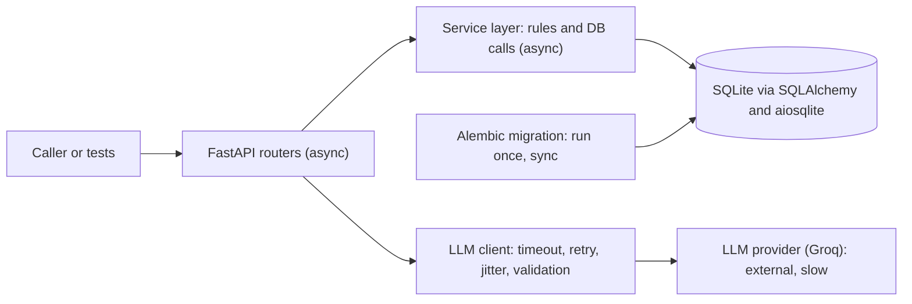
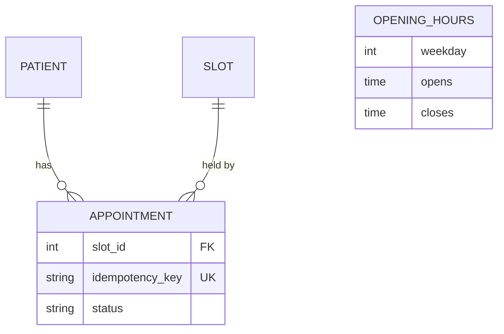

# Design

## Components

Routers stay thin. All booking rules live in the service layer. The LLM client
is isolated in one module so tests can replace it and nothing else knows which
provider is behind it.

## Sync vs async

| Call | Mode | Why |
|---|---|---|
| HTTP handlers | async | Every request waits on I/O, so one slow call must not block others |
| SQLite via aiosqlite | async | Keeps the event loop free |
| LLM call (wrapped in `asyncio.wait_for`) | async | The slowest call; a test proves two slow calls overlap |
| Alembic migrations | sync | Run once from the command line, outside the request path |
| Pydantic validation, small helpers | sync | CPU-only and fast |

## Data model

Two database-level guards make booking safe:

- `idempotency_key` is unique. Sending the same booking twice returns the first
  appointment and creates no second row.
- A partial unique index on `slot_id WHERE status = 'booked'`. Two live bookings
  can never share a slot, while a cancelled slot can be booked again.

The service checks the key first, then relies on the database to refuse the
loser of a race. It never trusts check-then-insert.

## LLM call

The caller's sentence goes in with a system prompt that includes an 8-day
calendar. The model must return one JSON object, which is validated against
`BookingIntent`.

- Explicit timeout on every attempt, at most 3 attempts, full-jitter backoff.
- Malformed JSON, schema violations, timeouts and provider errors are all
  retried; after the last attempt the endpoint returns a clean 502.
- A reply cut off by the token limit counts as a failure and is retried.
- The endpoint never returns unvalidated model text.

## Failure modes

| Failure | What happens |
|---|---|
| LLM timeout or provider error (including rate limits) | Retry with jitter, then 502 |
| Model returns invalid JSON or wrong shape | Retry, then 502 |
| Same booking sent twice | Same appointment returned, no new row |
| Two callers race for one slot | Unique index rejects one; the service returns 409 |
| Unknown slot or appointment id | 404 |

## If 100 clinics used it

- Add `clinic_id` to slots, patients and appointments; scope every query and
  every uniqueness rule by it; scope idempotency keys per clinic.
- Move from SQLite to Postgres with asyncpg and a connection pool. Run Alembic
  in the deploy pipeline, not at app start.
- Run several stateless app replicas behind a load balancer.
- LLM calls: a shared concurrency limit and per-clinic rate limits so one clinic
  cannot use up the provider quota; a queue if demand grows beyond that.
- Cache the slot list in Redis with a short TTL, invalidated on book, reschedule
  and cancel. Do not cache booking writes.
- Per-clinic API keys instead of an open API.

## Assumptions

| Assumption | Why it is safe for now |
|---|---|
| Open Monday to Saturday, 09:00 to 17:00, 30-minute slots | It is seed data; changing it only changes the seed |
| One chair per clinic, so a slot holds one appointment | Matches the partial unique index |
| Callers are identified by name and phone, no login | Fake data and no sensitive actions; revisit before real use |
| All times are the clinic's local time, stored without a time zone | One clinic, one zone |
| "Thursday" means the next Thursday on the calendar given to the model | Stated in the prompt rules |
| Tests build tables from the models; migrations are checked separately with `alembic check` | Keeps tests fast |